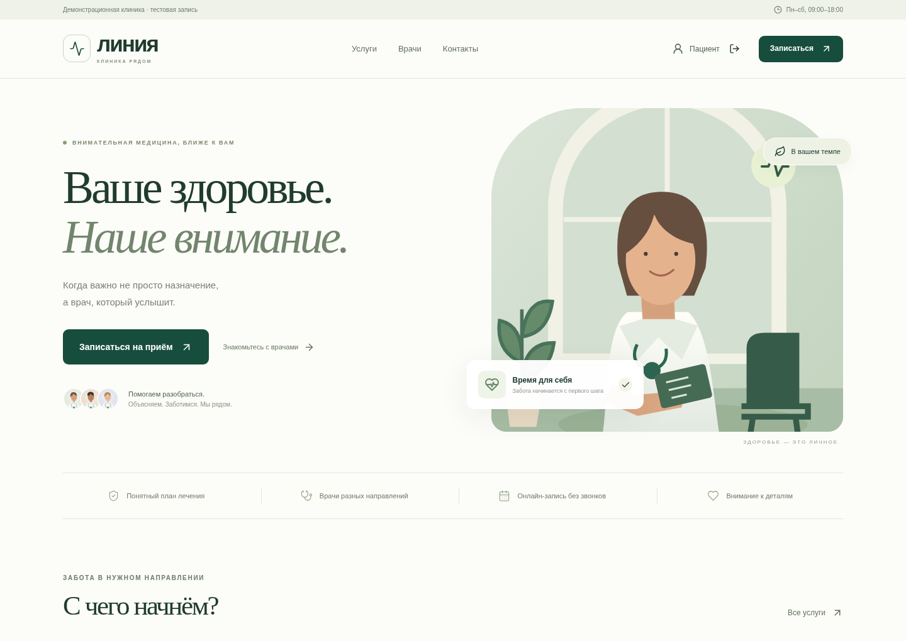

# Линия — сайт клиники

Полноценное приложение: React + Vite, серверное API на Node.js 24, сессии в HttpOnly cookie,
PostgreSQL для публикации на Vercel и постоянная SQLite-база для локальной разработки.
Учётные записи и приёмы хранятся на сервере. Данные пациентов не сохраняются в localStorage.

## Открыть прямо сейчас — без установки

- [Интерактивный предпросмотр](https://htmlpreview.github.io/?https://github.com/Romanov-vd/Codex/blob/main/deliverables/liniya-clinic.html)
- [Скачать сайт одним HTML-файлом](https://github.com/Romanov-vd/Codex/raw/refs/heads/main/deliverables/liniya-clinic.html)

Для автономного запуска скачайте HTML и откройте его в Chrome или Edge двойным щелчком.
Установка Node.js и запуск сервера для этого файла не требуются. Стили, скрипты и все
иллюстрации встроены в файл. Проверены регистрация, запись, перенос, отмена,
календарь, заявки и панель администратора при отключённой сети.

**Это локальная демонстрация:** данные сохраняются в IndexedDB текущего браузера,
не отправляются на сервер и не синхронизируются между устройствами. Используйте
тестовые имена и email. Не вводите медицинские сведения. При очистке данных браузера
демо-записи удаляются. Не следует использовать этот HTML в качестве рабочей медицинской системы.

Демо-администратор: `admin@local.test`, пароль `ClinicDemo2026!`.
Эта учётная запись существует только в автономном HTML и не добавляется в серверную версию.

Полная серверная версия с PostgreSQL/SQLite по-прежнему находится в этом проекте;
её запуск и публикация описаны ниже. Она использует серверные сессии, а не IndexedDB.

Сборка и тестирование автономного файла:

```sh
npm run build:standalone
CHROMIUM_PATH=/usr/bin/chromium npm run test:standalone
```

## Что работает

- Главная страница, каталог услуг, поиск и фильтрация врачей, карточка специалиста.
- Регистрация, вход, выход, сохранение сессии, редактирование имени и телефона.
- Запись: услуга → врач → свободное время → подтверждение.
- Личный кабинет с ближайшими приёмами и историей, перенос и отмена записи.
- Загрузка события для календаря в формате ICS.
- Защита от двойной записи на одно время, включая одновременные запросы разных пациентов.
- Форма обратного звонка: заявки попадают в панель администратора.
- Панель администратора: все записи, фильтр по дате, отмена приёма, заявки пациентов.
- Адаптивная версия, в том числе авторизация, модальные окна и выход из кабинета на телефоне.

Бренд, специалисты, иллюстрации, цены и адрес — демонстрационные. Это не сайт действующей
медицинской организации. Нет фиктивных отзывов и заявлений о медицинской лицензии.

## Локальный запуск

Нужен **Node.js 24**.

```sh
npm ci
npm run build
npm start
```

Открыть `http://localhost:3101`. SQLite-файл создастся в `data/clinic.sqlite`.
Он сохраняется между перезапусками. Не публикуйте папку `data`.

Режим разработки:

```sh
npm run dev
```

Сайт: `http://localhost:5173`, API: `http://localhost:3101`.
Vite автоматически перенаправляет запросы `/api` на сервер.

## Онлайн-публикация на Vercel

[Открыть мастер публикации Vercel](https://vercel.com/new/clone?repository-url=https%3A%2F%2Fgithub.com%2FRomanov-vd%2FCodex%2Ftree%2Fmain%2Fapps%2Fliniya-clinic&env=DATABASE_URL%2CADMIN_EMAIL%2CADMIN_PASSWORD&envDescription=%D0%A3%D0%BA%D0%B0%D0%B6%D0%B8%D1%82%D0%B5+URL+%D0%BF%D0%BE%D1%81%D1%82%D0%BE%D1%8F%D0%BD%D0%BD%D0%BE%D0%B9+PostgreSQL-%D0%B1%D0%B0%D0%B7%D1%8B+%D0%B8+%D0%B4%D0%B0%D0%BD%D0%BD%D1%8B%D0%B5+%D0%BD%D0%BE%D0%B2%D0%BE%D0%B3%D0%BE+%D0%B0%D0%B4%D0%BC%D0%B8%D0%BD%D0%B8%D1%81%D1%82%D1%80%D0%B0%D1%82%D0%BE%D1%80%D0%B0.+%D0%9F%D0%B0%D1%80%D0%BE%D0%BB%D1%8C+%E2%80%94+%D0%BC%D0%B8%D0%BD%D0%B8%D0%BC%D1%83%D0%BC+12+%D1%81%D0%B8%D0%BC%D0%B2%D0%BE%D0%BB%D0%BE%D0%B2.&project-name=liniya-clinic&repository-name=liniya-clinic)

Мастер скопирует проект в ваш аккаунт и запросит значения переменных.
Публикация выполняется после подключения базы и вашего входа в Vercel.


Для **работающего онлайн-кабинета** нужна постоянная PostgreSQL-база. Файловая система
Vercel Functions не подходит для хранения SQLite между запросами. В production приложение
не переключается на временный файл и не имитирует сохранение записей.

1. Создайте PostgreSQL-базу, например Neon, и получите **pooled connection string** с TLS.
   В Vercel это можно сделать через раздел Storage / Marketplace либо создать базу у провайдера.
2. Импортируйте репозиторий в Vercel. Если используется общий репозиторий `Romanov-vd/Codex`,
   выберите **Root Directory: `apps/liniya-clinic`**.
3. Framework: **Vite**; Build Command: `npm run build`; Output Directory: `dist`;
   Node.js: **24.x**. API описан в `api/index.js` и `vercel.json`.
4. В Environment Variables проекта добавьте:

| Переменная       | Значение                                                                             |
| ---------------- | ------------------------------------------------------------------------------------ |
| `DATABASE_URL`   | Строка подключения PostgreSQL; у Neon предпочтительно pooled URL с `sslmode=require` |
| `ADMIN_EMAIL`    | Email отдельного администратора                                                      |
| `ADMIN_PASSWORD` | Уникальный пароль администратора длиной не менее 12 символов                         |
| `APP_ORIGIN`     | Необязательно: ваш основной URL `https://...`, без завершающего `/`                  |

5. Выполните Deploy. Таблицы создаются автоматически при первом обращении к API;
   PostgreSQL advisory lock защищает инициализацию при одновременных холодных стартах.
6. Откройте сайт по адресу Vercel, зарегистрируйте пациента, создайте запись.
   В другом браузере войдите тем же пациентом: приём должен отображаться.
7. Для администратора войдите с `ADMIN_EMAIL` / `ADMIN_PASSWORD` и откройте `/admin`.

Без `DATABASE_URL` сервер вернёт `503` для функций кабинета: публичный каталог будет доступен,
но запись и авторизация не будут выдавать ложное подтверждение. Такой запуск не считается
полноценной онлайн-публикацией.

Секреты вводятся в настройках Vercel или `.env`, **не в исходном коде и не в переписке**.
После изменения переменных в Vercel выполните Redeploy.

Альтернатива через CLI после настройки базы и входа в аккаунт:

```sh
npx vercel login
npx vercel
```

Добавьте переменные в настройках созданного проекта, затем:

```sh
npx vercel --prod
```

### Администратор

Учётная запись создаётся автоматически из `ADMIN_EMAIL` и `ADMIN_PASSWORD`.
Используйте email, на который ещё не зарегистрирован пациент: существующая запись не получает
привилегии автоматически. Изменение `ADMIN_PASSWORD` в окружении не меняет пароль уже созданной
учётной записи. Для смены потребуется отдельная административная миграция.
Нет предустановленного публичного пароля администратора.

## Проверка

```sh
npm test
npm run build
npx playwright install chromium
npm run test:browser
```

Для установленного системного браузера:

```sh
CHROMIUM_PATH=/usr/bin/chromium npm run test:browser
```

Тесты создают изолированные временные базы и удаляют их после завершения.
Тестовые логины из `tests` не создаются в рабочей базе автоматически.

API-проверки включают валидацию, хеширование паролей, cookie, ограничения доступа, защиту
от запросов с другого origin, гонку двух пациентов за один слот, перенос, отмену,
администратора и ограничение числа попыток авторизации.

Браузерная проверка проходит сценарий регистрации внутри записи, подтверждение,
ICS, перенос, редактирование профиля, вход из второго браузера, отмену, историю,
заявку на звонок, панель администратора и мобильные разрешения 320/390/768/1440 px.

## Структура

- `src/main.jsx`, `src/styles.css` — интерфейс.
- `server/catalog.mjs` — услуги, специалисты, расписание. Все времена — Europe/Moscow.
- `server/api.mjs` — серверные маршруты.
- `server/db.mjs` — SQLite / PostgreSQL и создание таблиц.
- `server/security.mjs` — пароли, сессии, валидация, ограничения попыток.
- `api/index.js` — точка входа Vercel Function.
- `public/images` — собственные SVG-иллюстрации, без внешних запросов.
- `tests` — функциональные API- и браузерные проверки.

## Особенности

Приёмы доступны на 30 дней вперёд, с понедельника по субботу, по часовым слотам.
Длительность услуг — до 45 минут; один час закрепляется за одним приёмом, что исключает
пересечения. Новый слот выбирается не раньше чем через час от текущего момента.
Расписание в текущем варианте меняется в `server/catalog.mjs`.

Подтверждение появляется в кабинете; отправка писем и SMS не подключена и не обещается интерфейсом.
Восстановление пароля и приём платежей не имитируются. Для реальной клиники потребуется
добавить соответствующие провайдеры и её действительные реквизиты.

## Предпросмотр



[Мобильная версия](docs/preview-mobile.png)
